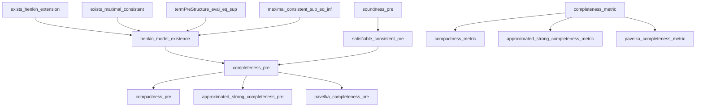

# Proof holes (ContinuousFOL / Ben Yaacov–Pedersen 2010)

Inventory of paper-facing Lean holes, ordered **prove-first**.

**Updated:** 2026-11-20T10:31:59Z
**Holes:** 37 open+blocked · 5 open · 32 blocked · 38 done.

**Live board:** [`holes.html`](holes.html) (graph embedded; open the file directly).

**Writeup:** [`ContinuousFOL.md`](ContinuousFOL.md).

```bash
python3 scripts/build_holes.py   # refreshes HOLES.md, holes-graph.json, embeds into holes.html
```

## Open now (Layer 0)

| Id | Label | File |
|---|---|---|
| `luk_weak_completeness` | Fact 4.1 Łuk weak | `ContinuousFOL/BlackBox/LukWeakCompleteness.lean:20` |
| `luk_consistent_iff_satisfiable` | Fact 4.2 Łuk cons | `ContinuousFOL/BlackBox/LukConsistentIffSatisfiable.lean:20` |
| `cl_consistent_iff_satisfiable` | Fact 4.3 CL cons | `ContinuousFOL/BlackBox/CLConsistentIffSatisfiable.lean:20` |
| `cl_approx_strong_completeness` | Fact 4.4 CL approx | `ContinuousFOL/BlackBox/CLApproxStrongCompleteness.lean:27` |
| `cl_finite_strong_completeness` | Fact 4.5 CL finite | `ContinuousFOL/BlackBox/CLFiniteStrongCompleteness.lean:21` |

## By section

### §1 — 0 hole(s)

| Status | Id | Label | File |
|---|---|---|---|
| done | `unit_closed_neg` | §1 ¬ closed | `ContinuousFOL/Introduction/UnitInterval.lean:19` |
| done | `unit_closed_half` | §1 ½ closed | `ContinuousFOL/Introduction/UnitInterval.lean:23` |

### §3 — 0 hole(s)

| Status | Id | Label | File |
|---|---|---|---|
| done | `DyadicCode.val_mem_Icc` | val ∈ [0,1] | `ContinuousFOL/Group1Axioms/DyadicCode/Val.lean:44` |
| done | `DyadicCode.dense_in_Icc` | Rem 3.4 denseness | `ContinuousFOL/Group1Axioms/DyadicCode/Val.lean:172` |
| done | `DyadicCode.val_range_eq_dyadics` | Rem 3.4 {v(d)}=𝔻 | `ContinuousFOL/Group1Axioms/DyadicCode/Val.lean:162` |

### §4 — 5 hole(s)

| Status | Id | Label | File |
|---|---|---|---|
| open | `luk_weak_completeness` | Fact 4.1 Łuk weak | `ContinuousFOL/BlackBox/LukWeakCompleteness.lean:20` |
| open | `luk_consistent_iff_satisfiable` | Fact 4.2 Łuk cons | `ContinuousFOL/BlackBox/LukConsistentIffSatisfiable.lean:20` |
| open | `cl_consistent_iff_satisfiable` | Fact 4.3 CL cons | `ContinuousFOL/BlackBox/CLConsistentIffSatisfiable.lean:20` |
| open | `cl_approx_strong_completeness` | Fact 4.4 CL approx | `ContinuousFOL/BlackBox/CLApproxStrongCompleteness.lean:27` |
| open | `cl_finite_strong_completeness` | Fact 4.5 CL finite | `ContinuousFOL/BlackBox/CLFiniteStrongCompleteness.lean:21` |
| done | `entails_empty_iff_evalMV` | MV eval on [0,1] | `ContinuousFOL/LukasiewiczAndContinuous/StandardMVAlgebra.lean:183` |
| done | `LukLind.mk_eq_zero_iff` | Lindenbaum [[φ]]=0 | `ContinuousFOL/LukasiewiczAndContinuous/LukLindenbaum.lean:251` |
| done | `LukPropForm.deduction_theorem` | WDT Łuk | `ContinuousFOL/LukasiewiczAndContinuous/LukPropFormDeduction.lean:212` |
| done | `CLPropForm.deduction_theorem` | WDT CL | `ContinuousFOL/LukasiewiczAndContinuous/CLPropFormDeduction.lean:212` |
| done | `LukPropForm.semantic_iteration` | Sem. iter. Łuk | `ContinuousFOL/LukasiewiczAndContinuous/LukPropFormSemanticIteration.lean:101` |
| done | `CLPropForm.semantic_iteration` | Sem. iter. CL | `ContinuousFOL/LukasiewiczAndContinuous/CLPropFormSemanticIteration.lean:111` |
| done | `LukPropForm.soundness` | Łuk soundness | `ContinuousFOL/LukasiewiczAndContinuous/LukPropFormSoundness.lean:50` |
| done | `CLPropForm.soundness` | CL soundness | `ContinuousFOL/LukasiewiczAndContinuous/CLPropFormSoundness.lean:60` |

### §5 — 0 hole(s)

| Status | Id | Label | File |
|---|---|---|---|
| done | `Formula.eval_in_Icc` | eval ∈ [0,1] | `ContinuousFOL/LanguageAndSemantics/FormulaEval.lean:34` |

### §6 — 0 hole(s)

| Status | Id | Label | File |
|---|---|---|---|
| done | `substitution_lemma` | Subst lemma | `ContinuousFOL/SubstitutionAndCompletions/SubstitutionLemma.lean:122` |
| done | `bound_substitution_lemma` | Bound subst | `ContinuousFOL/SubstitutionAndCompletions/BoundSubstitutionLemma.lean:381` |
| done | `bound_substitution_lemma_metric` | Bound subst met | `ContinuousFOL/SubstitutionAndCompletions/BoundSubstitutionLemma.lean:389` |
| done | `surjective_morphism_elementary` | Thm 6.6 elem. | `ContinuousFOL/SubstitutionAndCompletions/LMorphism.lean:44` |
| done | `exists_metric_completion` | Metric completion | `ContinuousFOL/SubstitutionAndCompletions/ExistsMetricCompletion.lean:20` |
| done | `eval_uniformly_continuous` | eval unif. cont. | `ContinuousFOL/SubstitutionAndCompletions/EvalUniformlyContinuous.lean:609` |
| done | `entails_metric_iff_complete` | Entails ↔ complete | `ContinuousFOL/SubstitutionAndCompletions/EntailsMetricIffComplete.lean:22` |
| done | `satisfiable_metric_iff_complete` | Sat ↔ complete | `ContinuousFOL/SubstitutionAndCompletions/EntailsMetricIffComplete.lean:37` |

### §7 — 0 hole(s)

| Status | Id | Label | File |
|---|---|---|---|
| done | `soundness_pre` | Thm 7.2 sound | `ContinuousFOL/Group2Axioms/SoundnessPre.lean:137` |
| done | `satisfiable_consistent_pre` | Sat ⇒ Cons (pre) | `ContinuousFOL/Group2Axioms/SoundnessPre.lean:158` |
| done | `soundness_metric` | Thm 7.2 metric | `ContinuousFOL/Group2Axioms/SoundnessMetric.lean:138` |
| done | `satisfiable_consistent_metric` | Sat ⇒ Cons (met) | `ContinuousFOL/Group2Axioms/SoundnessMetric.lean:151` |

### §8 — 15 hole(s)

| Status | Id | Label | File |
|---|---|---|---|
| blocked | `deduction_theorem` | Deduction | `ContinuousFOL/Essentials/DeductionTheorem.lean:167` |
| blocked | `deduction_theorem_metric` | Deduction met | `ContinuousFOL/Essentials/DeductionTheorem.lean:235` |
| done | `generalization_theorem` | Generalization | `ContinuousFOL/Essentials/GeneralizationTheorem.lean:21` |
| done | `generalization_theorem_metric` | Generalization met | `ContinuousFOL/Essentials/GeneralizationTheorem.lean:39` |
| blocked | `generalize_fresh_const` | Fresh const gen | `ContinuousFOL/Essentials/GeneralizeFreshConst.lean:310` |
| blocked | `generalize_fresh_const_metric` | Fresh const gen met | `ContinuousFOL/Essentials/GeneralizeFreshConst.lean:437` |
| done | `ProvableQ.tsub_one` | ⊢ φ ∸ 1 | `ContinuousFOL/Essentials/InconsistentIffProvableOne.lean:90` |
| done | `inconsistent_iff_provable_one` | Incons ↔ ⊢1 | `ContinuousFOL/Essentials/InconsistentIffProvableOne.lean:104` |
| done | `inconsistent_iff_provable_one_metric` | Incons ↔ ⊢1 met | `ContinuousFOL/Essentials/MaximalConsistentMetric.lean:83` |
| blocked | `provable_bound_subst` | ⊢ bound subst | `ContinuousFOL/Essentials/ProvableBoundSubst.lean:439` |
| blocked | `provable_bound_subst_metric` | ⊢ bound subst met | `ContinuousFOL/Essentials/ProvableBoundSubst.lean:498` |
| blocked | `consistent_adjoin_approx` | Adjoin approx | `ContinuousFOL/Essentials/ConsistentAdjoin.lean:131` |
| blocked | `consistent_adjoin_approx_metric` | Adjoin approx met | `ContinuousFOL/Essentials/ConsistentAdjoin.lean:183` |
| blocked | `consistent_adjoin_comparable` | Adjoin comparable | `ContinuousFOL/Essentials/ConsistentAdjoin.lean:153` |
| blocked | `consistent_adjoin_comparable_metric` | Adjoin comparable met | `ContinuousFOL/Essentials/ConsistentAdjoin.lean:204` |
| done | `mem_iff_provable` | ∈ ↔ ⊢ (max) | `ContinuousFOL/Essentials/MaximalConsistent.lean:40` |
| done | `MaximalConsistentMetric.mem_iff_provable` | ∈ ↔ ⊢ (max) met | `ContinuousFOL/Essentials/MaximalConsistentMetric.lean:130` |
| blocked | `maximal_consistent_sup_instantiate` | sup instantiate | `ContinuousFOL/Essentials/MaximalConsistent.lean:199` |
| blocked | `maximal_consistent_sup_instantiate_metric` | sup instantiate met | `ContinuousFOL/Essentials/MaximalConsistentMetric.lean:197` |
| blocked | `maximal_consistent_sup_instantiate_aux` | 8.11 helper | `ContinuousFOL/Essentials/MaximalConsistent.lean:173` |
| done | `maximal_consistent_sup_eq_inf` | sup = Inf | `ContinuousFOL/Essentials/MaximalConsistent.lean:247` |
| done | `maximal_consistent_sup_eq_inf_metric` | sup = Inf met | `ContinuousFOL/Essentials/MaximalConsistentMetric.lean:210` |
| done | `maximal_in_consistent_extensions_iff` | Max ↔ no ext | `ContinuousFOL/Essentials/MaximalConsistent.lean:319` |
| done | `maximal_in_consistent_extensions_iff_metric` | Max ↔ no ext met | `ContinuousFOL/Essentials/MaximalConsistentMetric.lean:180` |
| blocked | `exists_maximal_consistent` | Thm 8.10 Lindenbaum | `ContinuousFOL/Essentials/MaximalConsistent.lean:334` |
| blocked | `exists_maximal_consistent_metric` | Thm 8.10 metric | `ContinuousFOL/Essentials/MaximalConsistentMetric.lean:55` |

### §9 — 17 hole(s)

| Status | Id | Label | File |
|---|---|---|---|
| done | `eval_reduct` | eval reduct | `ContinuousFOL/Completeness/SignatureExtension.lean:72` |
| blocked | `exists_henkin_extension` | Henkin extension | `ContinuousFOL/Completeness/ExistsHenkinExtension.lean:807` |
| blocked | `exists_henkin_extension_metric` | Henkin ext met | `ContinuousFOL/Completeness/ExistsHenkinExtension.lean:932` |
| blocked | `termPreStructure_eval_eq_sup` | term eval = Inf | `ContinuousFOL/Completeness/TermPreStructureEvalEqSup.lean:316` |
| blocked | `henkin_model_existence` | Thm 9.4 Henkin | `ContinuousFOL/Completeness/HenkinModelExistence.lean:24` |
| blocked | `henkin_model_existence_metric` | Thm 9.4 metric | `ContinuousFOL/Completeness/HenkinModelExistenceMetric.lean:177` |
| blocked | `metric_prestructure_model_of_consistent` | 9.5 met helper | `ContinuousFOL/Completeness/HenkinModelExistenceMetric.lean:157` |
| blocked | `completeness_pre` | Thm 9.5 complete | `ContinuousFOL/Completeness/CompletenessPre.lean:21` |
| blocked | `completeness_metric` | Thm 9.5 metric | `ContinuousFOL/Completeness/CompletenessMetric.lean:22` |
| blocked | `provable_tsub_of_inconsistent_adjoin` | ⊢ φ∸p from ⊥ | `ContinuousFOL/Completeness/ProvableTsubOfInconsistentAdjoin.lean:81` |
| blocked | `provable_tsub_of_inconsistent_adjoin_metric` | ⊢ φ∸p met | `ContinuousFOL/Completeness/ProvableTsubOfInconsistentAdjoin.lean:92` |
| blocked | `approximated_strong_completeness_pre` | Cor 9.6 approx | `ContinuousFOL/Completeness/ApproximatedStrongCompleteness.lean:24` |
| blocked | `approximated_strong_completeness_metric` | Cor 9.6 metric | `ContinuousFOL/Completeness/ApproximatedStrongCompleteness.lean:118` |
| blocked | `pavelka_completeness_pre` | Cor 9.8 Pavelka | `ContinuousFOL/Completeness/PavelkaCompleteness.lean:200` |
| blocked | `pavelka_completeness_metric` | Cor 9.8 metric | `ContinuousFOL/Completeness/PavelkaCompleteness.lean:207` |
| blocked | `compactness_pre` | Cor 9.12 compact | `ContinuousFOL/Completeness/CompactnessPre.lean:21` |
| blocked | `compactness_metric` | Cor 9.12 metric | `ContinuousFOL/Completeness/CompactnessMetric.lean:59` |
| blocked | `complete_re_theory_decidable` | Cor 9.11 RE ⇒ dec. | `ContinuousFOL/Completeness/UniformlyComputableDegree.lean:1311` |

## Dependency sketch



