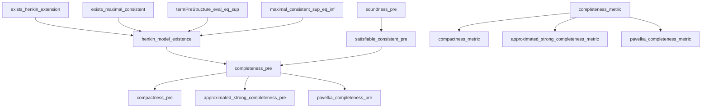

# Proof holes (ContinuousFOL / Ben Yaacov–Pedersen 2010)

Inventory of paper-facing Lean holes, ordered **prove-first**.

**Updated:** 2026-11-19T17:31:55Z
**Holes:** 32 open+blocked · 17 open · 15 blocked · 21 done.

**Live board:** [`holes.html`](holes.html) (graph embedded; open the file directly).

**Writeup:** [`ContinuousFOL.md`](ContinuousFOL.md).

```bash
python3 scripts/build_holes.py   # refreshes HOLES.md, holes-graph.json, embeds into holes.html
```

## Open now (Layer 0)

| Id | Label | File |
|---|---|---|
| `cl_consistent_iff_satisfiable` | Fact 4.1 CL | `ContinuousFOL/BlackBox/CLConsistentIffSatisfiable.lean:20` |
| `cl_finite_strong_completeness` | Fact 4.2 finite | `ContinuousFOL/BlackBox/CLFiniteStrongCompleteness.lean:21` |
| `cl_approx_strong_completeness` | Fact 4.3 approx | `ContinuousFOL/BlackBox/CLApproxStrongCompleteness.lean:22` |
| `luk_consistent_iff_satisfiable` | Fact 4.4 Łuk | `ContinuousFOL/BlackBox/LukConsistentIffSatisfiable.lean:20` |
| `luk_weak_completeness` | Fact 4.5 weak | `ContinuousFOL/BlackBox/LukWeakCompleteness.lean:20` |
| `exists_metric_completion` | Metric completion | `ContinuousFOL/SubstitutionAndCompletions/ExistsMetricCompletion.lean:21` |
| `eval_uniformly_continuous` | eval unif. cont. | `ContinuousFOL/SubstitutionAndCompletions/EvalUniformlyContinuous.lean:21` |
| `soundness_metric` | Thm 7.2 metric | `ContinuousFOL/Group2Axioms/SoundnessMetric.lean:21` |
| `generalize_fresh_const` | Fresh const gen | `ContinuousFOL/Essentials/GeneralizeFreshConst.lean:20` |
| `provable_bound_subst` | ⊢ bound subst | `ContinuousFOL/Essentials/ProvableBoundSubst.lean:99` |
| `consistent_adjoin_approx` | Adjoin approx | `ContinuousFOL/Essentials/ConsistentAdjoin.lean:20` |
| `consistent_adjoin_comparable` | Adjoin comparable | `ContinuousFOL/Essentials/ConsistentAdjoin.lean:26` |
| `maximal_consistent_sup_instantiate` | sup instantiate | `ContinuousFOL/Essentials/MaximalConsistent.lean:70` |
| `exists_maximal_consistent_metric` | Thm 8.10 metric | `ContinuousFOL/Essentials/MaximalConsistentMetric.lean:27` |
| `exists_henkin_extension` | Henkin extension | `ContinuousFOL/Completeness/ExistsHenkinExtension.lean:22` |
| `exists_henkin_extension_metric` | Henkin ext met | `ContinuousFOL/Completeness/ExistsHenkinExtension.lean:28` |
| `termPreStructure_eval_eq_sup` | term eval = Inf | `ContinuousFOL/Completeness/TermPreStructureEvalEqSup.lean:22` |

## By section

### §1 — 0 hole(s)

| Status | Id | Label | File |
|---|---|---|---|
| done | `unit_closed_neg` | §1 ¬ closed | `ContinuousFOL/Introduction/UnitInterval.lean:19` |
| done | `unit_closed_half` | §1 ½ closed | `ContinuousFOL/Introduction/UnitInterval.lean:23` |

### §3 — 0 hole(s)

| Status | Id | Label | File |
|---|---|---|---|
| done | `DyadicCode.val_mem_Icc` | val ∈ [0,1] | `ContinuousFOL/Group1Axioms/DyadicCode/Val.lean:44` |
| done | `DyadicCode.dense_in_Icc` | Rem 3.4 denseness | `ContinuousFOL/Group1Axioms/DyadicCode/Val.lean:91` |

### §4 — 5 hole(s)

| Status | Id | Label | File |
|---|---|---|---|
| open | `cl_consistent_iff_satisfiable` | Fact 4.1 CL | `ContinuousFOL/BlackBox/CLConsistentIffSatisfiable.lean:20` |
| open | `cl_finite_strong_completeness` | Fact 4.2 finite | `ContinuousFOL/BlackBox/CLFiniteStrongCompleteness.lean:21` |
| open | `cl_approx_strong_completeness` | Fact 4.3 approx | `ContinuousFOL/BlackBox/CLApproxStrongCompleteness.lean:22` |
| open | `luk_consistent_iff_satisfiable` | Fact 4.4 Łuk | `ContinuousFOL/BlackBox/LukConsistentIffSatisfiable.lean:20` |
| open | `luk_weak_completeness` | Fact 4.5 weak | `ContinuousFOL/BlackBox/LukWeakCompleteness.lean:20` |

### §5 — 0 hole(s)

| Status | Id | Label | File |
|---|---|---|---|
| done | `Formula.eval_in_Icc` | eval ∈ [0,1] | `ContinuousFOL/LanguageAndSemantics/FormulaEval.lean:34` |

### §6 — 4 hole(s)

| Status | Id | Label | File |
|---|---|---|---|
| done | `substitution_lemma` | Subst lemma | `ContinuousFOL/SubstitutionAndCompletions/SubstitutionLemma.lean:122` |
| done | `bound_substitution_lemma` | Bound subst | `ContinuousFOL/SubstitutionAndCompletions/BoundSubstitutionLemma.lean:193` |
| done | `surjective_morphism_elementary` | Thm 6.6 elem. | `ContinuousFOL/SubstitutionAndCompletions/LMorphism.lean:44` |
| open | `exists_metric_completion` | Metric completion | `ContinuousFOL/SubstitutionAndCompletions/ExistsMetricCompletion.lean:21` |
| open | `eval_uniformly_continuous` | eval unif. cont. | `ContinuousFOL/SubstitutionAndCompletions/EvalUniformlyContinuous.lean:21` |
| blocked | `entails_metric_iff_complete` | Entails ↔ complete | `ContinuousFOL/SubstitutionAndCompletions/EntailsMetricIffComplete.lean:22` |
| blocked | `satisfiable_metric_iff_complete` | Sat ↔ complete | `ContinuousFOL/SubstitutionAndCompletions/EntailsMetricIffComplete.lean:37` |

### §7 — 2 hole(s)

| Status | Id | Label | File |
|---|---|---|---|
| done | `soundness_pre` | Thm 7.2 sound | `ContinuousFOL/Group2Axioms/SoundnessPre.lean:223` |
| done | `satisfiable_consistent_pre` | Sat ⇒ Cons (pre) | `ContinuousFOL/Group2Axioms/SoundnessPre.lean:244` |
| open | `soundness_metric` | Thm 7.2 metric | `ContinuousFOL/Group2Axioms/SoundnessMetric.lean:21` |
| blocked | `satisfiable_consistent_metric` | Sat ⇒ Cons (met) | `ContinuousFOL/Group2Axioms/SoundnessMetric.lean:26` |

### §8 — 7 hole(s)

| Status | Id | Label | File |
|---|---|---|---|
| done | `deduction_theorem` | Deduction | `ContinuousFOL/Essentials/DeductionTheorem.lean:208` |
| done | `deduction_theorem_metric` | Deduction met | `ContinuousFOL/Essentials/DeductionTheorem.lean:258` |
| done | `generalization_theorem` | Generalization | `ContinuousFOL/Essentials/GeneralizationTheorem.lean:20` |
| open | `generalize_fresh_const` | Fresh const gen | `ContinuousFOL/Essentials/GeneralizeFreshConst.lean:20` |
| done | `ProvableQ.tsub_one` | ⊢ φ ∸ 1 | `ContinuousFOL/Essentials/InconsistentIffProvableOne.lean:90` |
| done | `inconsistent_iff_provable_one` | Incons ↔ ⊢1 | `ContinuousFOL/Essentials/InconsistentIffProvableOne.lean:104` |
| open | `provable_bound_subst` | ⊢ bound subst | `ContinuousFOL/Essentials/ProvableBoundSubst.lean:99` |
| open | `consistent_adjoin_approx` | Adjoin approx | `ContinuousFOL/Essentials/ConsistentAdjoin.lean:20` |
| open | `consistent_adjoin_comparable` | Adjoin comparable | `ContinuousFOL/Essentials/ConsistentAdjoin.lean:26` |
| done | `mem_iff_provable` | ∈ ↔ ⊢ (max) | `ContinuousFOL/Essentials/MaximalConsistent.lean:40` |
| open | `maximal_consistent_sup_instantiate` | sup instantiate | `ContinuousFOL/Essentials/MaximalConsistent.lean:70` |
| blocked | `maximal_consistent_sup_eq_inf` | sup = Inf | `ContinuousFOL/Essentials/MaximalConsistent.lean:79` |
| done | `maximal_in_consistent_extensions_iff` | Max ↔ no ext | `ContinuousFOL/Essentials/MaximalConsistent.lean:86` |
| done | `exists_maximal_consistent` | Thm 8.10 Lindenbaum | `ContinuousFOL/Essentials/MaximalConsistent.lean:120` |
| open | `exists_maximal_consistent_metric` | Thm 8.10 metric | `ContinuousFOL/Essentials/MaximalConsistentMetric.lean:27` |

### §9 — 14 hole(s)

| Status | Id | Label | File |
|---|---|---|---|
| done | `eval_reduct` | eval reduct | `ContinuousFOL/Completeness/SignatureExtension.lean:72` |
| open | `exists_henkin_extension` | Henkin extension | `ContinuousFOL/Completeness/ExistsHenkinExtension.lean:22` |
| open | `exists_henkin_extension_metric` | Henkin ext met | `ContinuousFOL/Completeness/ExistsHenkinExtension.lean:28` |
| open | `termPreStructure_eval_eq_sup` | term eval = Inf | `ContinuousFOL/Completeness/TermPreStructureEvalEqSup.lean:22` |
| blocked | `henkin_model_existence` | Thm 9.4 Henkin | `ContinuousFOL/Completeness/HenkinModelExistence.lean:24` |
| blocked | `henkin_model_existence_metric` | Thm 9.4 metric | `ContinuousFOL/Completeness/HenkinModelExistenceMetric.lean:19` |
| blocked | `completeness_pre` | Thm 9.5 complete | `ContinuousFOL/Completeness/CompletenessPre.lean:20` |
| blocked | `completeness_metric` | Thm 9.5 metric | `ContinuousFOL/Completeness/CompletenessMetric.lean:21` |
| done | `provable_tsub_of_inconsistent_adjoin` | ⊢ φ∸p from ⊥ | `ContinuousFOL/Completeness/ProvableTsubOfInconsistentAdjoin.lean:81` |
| done | `provable_tsub_of_inconsistent_adjoin_metric` | ⊢ φ∸p met | `ContinuousFOL/Completeness/ProvableTsubOfInconsistentAdjoin.lean:92` |
| blocked | `approximated_strong_completeness_pre` | Cor 9.6 approx | `ContinuousFOL/Completeness/ApproximatedStrongCompleteness.lean:24` |
| blocked | `approximated_strong_completeness_metric` | Cor 9.6 metric | `ContinuousFOL/Completeness/ApproximatedStrongCompleteness.lean:52` |
| blocked | `pavelka_completeness_pre` | Cor 9.8 Pavelka | `ContinuousFOL/Completeness/PavelkaCompleteness.lean:24` |
| blocked | `pavelka_completeness_metric` | Cor 9.8 metric | `ContinuousFOL/Completeness/PavelkaCompleteness.lean:29` |
| blocked | `compactness_pre` | Cor 9.12 compact | `ContinuousFOL/Completeness/CompactnessPre.lean:21` |
| blocked | `compactness_metric` | Cor 9.12 metric | `ContinuousFOL/Completeness/CompactnessMetric.lean:22` |
| blocked | `complete_re_theory_decidable` | RE ⇒ decidable | `ContinuousFOL/Completeness/UniformlyComputableDegree.lean:33` |

## Dependency sketch



